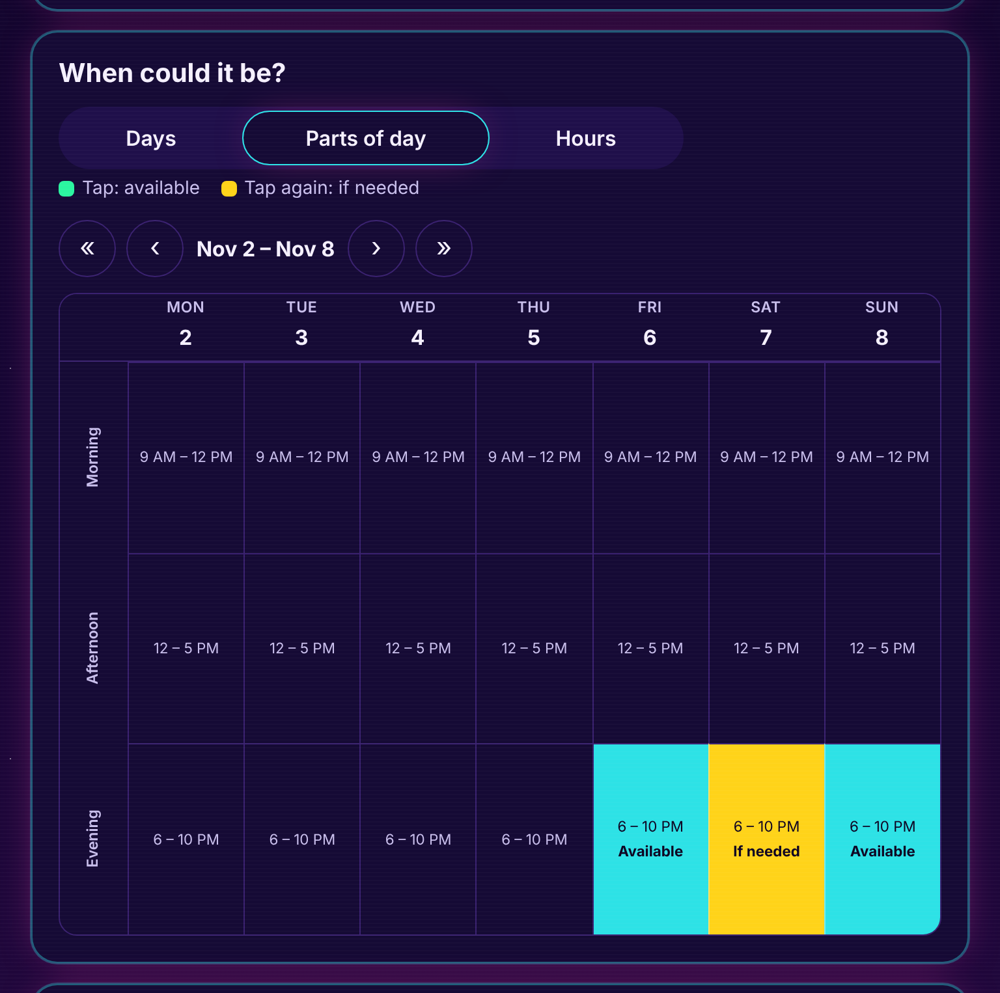
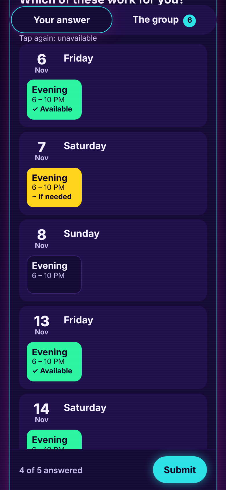

<p align="center">
  <a href="https://venn.day/?retro=1"></a>
</p>

<p align="center">
  <strong>Less group chat. More plans.</strong><br>
  Free, open-source polls for finding the day that works for everyone.<br>
  No accounts. No ads. No tracking. No build step.
</p>

<p align="center">
  <a href="https://github.com/sephmard/venn/actions/workflows/ci.yml"></a>
  
  
  <a href="LICENSE"></a>
</p>

<p align="center">
  <a href="https://venn.day/?retro=1"><strong>Use it at venn.day</strong></a> ·
  <a href="https://docs.venn.day">Docs</a> ·
  <a href="https://docs.venn.day/api.html">API</a> ·
  <a href="#deploy-your-own">Deploy your own</a> ·
  <a href="CONTRIBUTING.md">Contribute</a>
</p>


## What it does

Pick the days, parts of the day or hours that could work and share the link. Everyone taps _Yes_, _If needed_ or _No_ without signing up, and Venn shows where they overlap, best date first. Pick it and everyone adds it to their calendar. Time zones, link previews, places, privacy controls and email, Slack, Discord or webhook notifications are built in, and any poll can switch on the retro look shown here.

## Why developers like it

- **No framework, no build.** Plain HTML, CSS and ES modules in `public/`, served as-is.
- **One API, two hosts.** Web-standard `Request` → `Response` (`src/api.js`), run as a Cloudflare Worker with D1 or a Node server with SQLite.
- **Small on purpose.** A poll opens in 46 KB gzipped or less; a test fails the build if it grows.
- **Private by design.** No accounts or cookies. Edit links carry secrets the server stores only as SHA-256 hashes.
- **Optional extras.** Email, calendar free-busy, address search and AI help switch on only when configured.

## Make a poll with one request

```sh
curl https://venn.day/api/events \
  -H 'content-type: application/json' \
  -d '{"title": "Book club", "timezone": "Europe/London", "mode": "options",
       "options": [{"start": 1794337200000, "end": 1794344400000}]}'

# {"id": "cXar7oEEBo", "adminToken": "…"}  →  share https://venn.day/e/cXar7oEEBo
```

Every answer can post a signed webhook (`X-Venn-Signature`). See the [API reference](docs/API.md) and [webhook guide](docs/NOTIFICATIONS.md#webhooks).

## Deploy your own

[](https://deploy.workers.cloudflare.com/?url=https://github.com/sephmard/venn)

```sh
npx wrangler d1 create venn   # paste the database_id into wrangler.toml
npx wrangler deploy           # tables are created on the first request
```

Or anywhere with Node 22.13+: `PORT=3000 DB_PATH=/var/lib/venn/venn.db node server.js`. The [self-hosting guide](docs/SELF-HOSTING.md) covers domains, email, calendars and AI.

## Run it locally

```sh
git clone https://github.com/sephmard/venn.git && cd venn
npm install
npm start          # http://localhost:8787
npm run check      # lint, formatting, docs links, unit and API tests
npm run test:e2e   # browser and accessibility tests, desktop and phone
```

<details>
<summary><strong>More screenshots</strong></summary>



<p align="center">
  
</p>

</details>

## Contributing

Pull requests are welcome, from typo fixes to features: start with [CONTRIBUTING.md](CONTRIBUTING.md). Security issues go to [SECURITY.md](SECURITY.md). Ideas? [Open an issue](https://github.com/sephmard/venn/issues/new/choose).

## License

[MIT](LICENSE). Please follow the [Code of Conduct](CODE_OF_CONDUCT.md).
