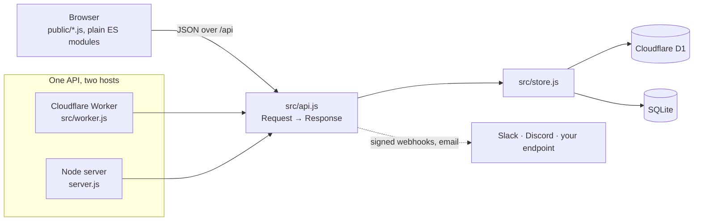

<p align="center">
  <a href="https://venn.day"></a>
</p>

<h1 align="center">Venn</h1>

<p align="center">
  <strong>Less group chat. More plans.</strong><br>
  Free, open-source polls for finding the day that works for everyone.<br>
  No accounts. No ads. No tracking. No build step.
</p>

<p align="center">
  <a href="https://github.com/sephmard/venn/actions/workflows/ci.yml"></a>
  <a href="https://scorecard.dev/viewer/?uri=github.com/sephmard/venn"></a>
  
  
  <a href="https://workers.cloudflare.com"></a>
  <a href="LICENSE"></a>
</p>

<p align="center">
  <a href="https://venn.day"><strong>Use it at venn.day</strong></a> ·
  <a href="https://docs.venn.day">Docs</a> ·
  <a href="https://docs.venn.day/api.html">API</a> ·
  <a href="#deploy-your-own">Deploy your own</a> ·
  <a href="CONTRIBUTING.md">Contribute</a>
</p>

<picture>
  <source media="(prefers-color-scheme: dark)" srcset="docs/screenshots/results-dark.png">
  
</picture>

## Why developers like it

|                             |                                                                                                                                              |
| --------------------------- | -------------------------------------------------------------------------------------------------------------------------------------------- |
| **No framework, no build**  | Plain HTML, CSS and ES modules in `public/`, served as-is. Clone it and read it; there's nothing to compile.                                 |
| **One codebase, two hosts** | The API is web-standard `Request` → `Response`. It runs as a Cloudflare Worker with D1, or as a Node server with `node:sqlite`.              |
| **Small on purpose**        | A poll opens in under 45 KB gzipped, and each create page stays under 46 KB. A test fails the build if they grow.                            |
| **An API and webhooks**     | Create polls, collect answers and pick the date over JSON. Every answer can post a signed webhook to Slack, Discord or your endpoint.        |
| **Private by design**       | No accounts or cookies. Edit links carry secrets the server stores only as SHA-256 hashes. Calendar checks (coming soon) run in the browser. |
| **Checked on every change** | Unit and API tests with a coverage floor, browser tests on desktop and phone, axe accessibility audits in light and dark, CodeQL.            |
| **Optional extras**         | Email (Resend), Google and Outlook free-busy, and AI help (Claude) switch on when their settings exist, and stay off otherwise.              |

## Make a poll with one request

```sh
curl https://venn.day/api/events \
  -H 'content-type: application/json' \
  -d '{"title": "Book club",
       "timezone": "Europe/London",
       "mode": "options",
       "options": [{"start": 1794337200000, "end": 1794344400000}]}'

# {"id": "cXar7oEEBo", "adminToken": "…"}  →  share https://venn.day/e/cXar7oEEBo
```

Then, every time someone answers, your webhook gets a signed `POST` (trimmed here):

```json
{
  "event": "response.created",
  "poll": { "id": "cXar7oEEBo", "title": "Book club", "responses": 6, "finalStart": null },
  "response": { "name": "Ana" },
  "bestTime": { "start": "2026-11-10T19:00:00.000Z", "available": 5, "ifNeeded": 1 }
}
```

Verify it with `X-Venn-Signature` (HMAC-SHA256 of `"<timestamp>.<body>"`). The [API reference](docs/API.md) and [webhook guide](docs/NOTIFICATIONS.md#webhooks) have every endpoint and field.

## Deploy your own

**On Cloudflare (free plan is plenty):**

[](https://deploy.workers.cloudflare.com/?url=https://github.com/sephmard/venn)

```sh
npx wrangler d1 create venn   # paste the database_id into wrangler.toml
npx wrangler deploy           # tables are created on the first request
```

**Anywhere with Node 22.13+:**

```sh
PORT=3000 DB_PATH=/var/lib/venn/venn.db node server.js
```

The [self-hosting guide](docs/SELF-HOSTING.md) covers custom domains, deploying from GitHub Actions, and turning on email, calendars and AI.

## Run it locally

```sh
git clone https://github.com/sephmard/venn.git && cd venn
npm install
npm start          # http://localhost:8787, polls saved to data/venn.db
```

## How it fits together



Time zones, ranking and calendar files live in `public/core.js`, shared by the browser and the server. The [developer docs](https://docs.venn.day) walk through the [project layout](docs/INTRODUCTION.md#how-its-built), the [API](docs/API.md) and [self-hosting](docs/SELF-HOSTING.md).

## What people get

- **Two kinds of poll.** Vote on a few dates, or ask when people are free: paint the hours on a calendar, or pick whole days, or days in a row for a trip.
- **Nobody signs up.** Open the link, type a name, tap _Yes_, _If needed_ or _No_. It's built for phones first.
- **The organizer's poll is their answer:** the times they offer count as theirs. They can edit the poll until someone answers, then duplicate it.
- **The best date rises to the top,** with everyone who can make it. Pick it and everyone adds it to Google, Apple or Outlook Calendar.
- **Privacy controls for organizers:** ask everyone for their email, hide names, or hide everyone's answers so only you see them.
- **Time zones handled,** and **notifications** by email, Slack, Discord or your own webhook. Checking your calendar is coming soon.
- **Accessible:** keyboard and screen-reader friendly, with WCAG AA contrast in light and dark mode.

<details>
<summary><strong>Screenshots</strong></summary>

<picture>
  <source media="(prefers-color-scheme: dark)" srcset="docs/screenshots/create-dark.png">
  
</picture>

<p align="center">
  <picture>
    <source media="(prefers-color-scheme: dark)" srcset="docs/screenshots/mobile-dark.png">
    
  </picture>
</p>

</details>

## Privacy

Venn stores only what people type into a poll. There are no accounts, cookies or analytics. Organizer and edit links carry a secret after the `#`, which browsers never send; the server keeps only a SHA-256 hash, so a database leak can't be used to edit polls. People can remove their own answers, and organizers can delete the whole poll. Found a security issue? Please report it privately: see [SECURITY.md](SECURITY.md).

## Contributing

Pull requests are welcome, from typo fixes to features. [CONTRIBUTING.md](CONTRIBUTING.md) covers setup and review, and [CI.md](docs/CI.md) explains the checks. Docs-only changes finish in about 30 seconds.

```sh
npm run check          # lint, formatting, docs links, unit and API tests
npm run test:e2e       # browser and accessibility tests, desktop and phone
npm run test:coverage  # unit tests with the coverage floor
npm run site           # build the developer docs into site/
```

**Roadmap:** recurring "any week" polls, translations, and built-in rate limiting for the whole API. Have an idea? [Open an issue](https://github.com/sephmard/venn/issues/new/choose).

## License

[MIT](LICENSE). Please follow the [Code of Conduct](CODE_OF_CONDUCT.md).
