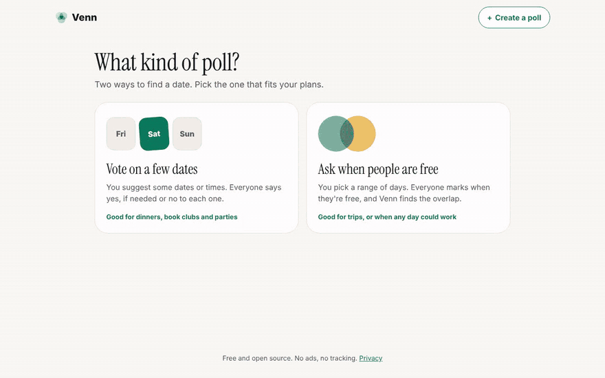
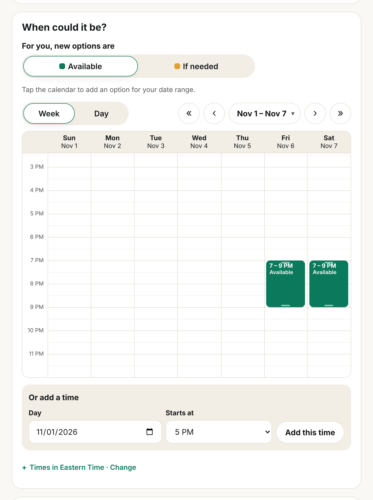
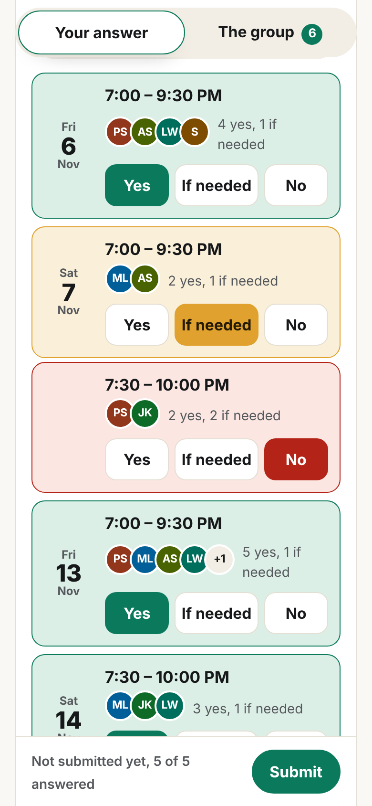
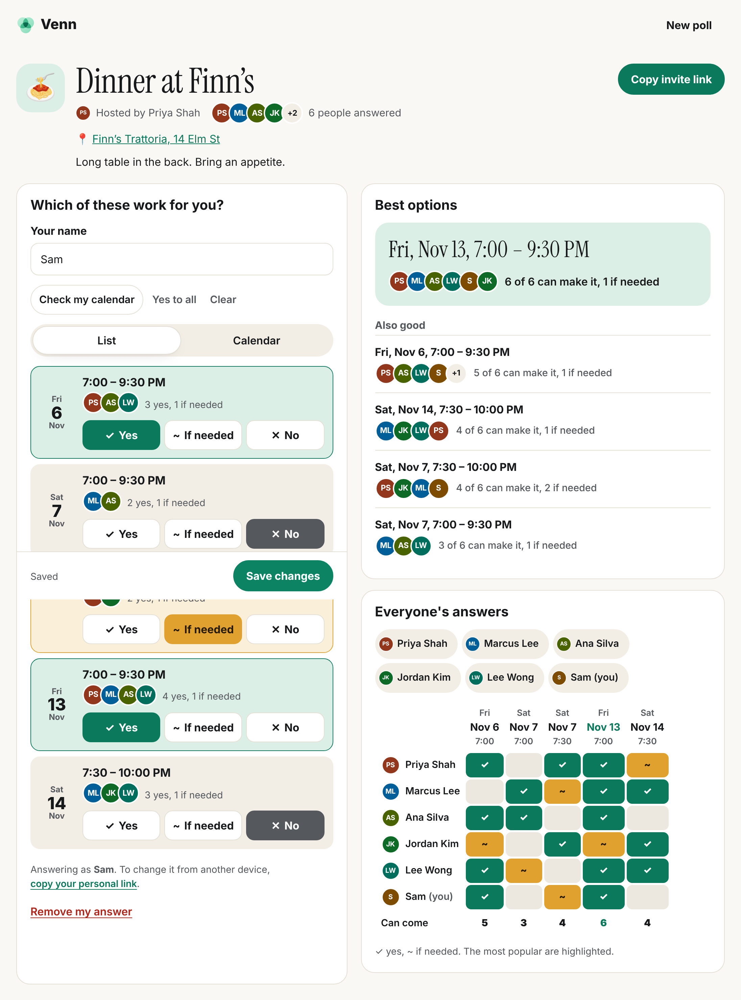

<p align="center">
  
</p>

<h1 align="center">Venn</h1>

<p align="center">
  <strong>Find a time that works for everyone.</strong><br>
  Free scheduling polls. Propose a few times, share one link, and see where everyone's availability overlaps.<br>
  No accounts. No ads. No tracking.
</p>

<p align="center">
  <a href="https://github.com/sephmard/venn/actions/workflows/ci.yml"></a>
  <a href="LICENSE"></a>
  <a href="CONTRIBUTING.md"></a>
  <a href="https://scorecard.dev/viewer/?uri=github.com/sephmard/venn"></a>
</p>

<p align="center">
  <a href="https://venn.day"><strong>Try it at venn.day</strong></a> ·
  <a href="https://docs.venn.day">Docs</a> ·
  <a href="#quick-start">Quick start</a> ·
  <a href="#self-hosting">Self-hosting</a> ·
  <a href="#privacy">Privacy</a> ·
  <a href="CONTRIBUTING.md">Contributing</a>
</p>

<p align="center">
  
</p>

## Why Venn

Everyone's availability is a circle. Venn finds where they overlap.

- **Free, with no accounts.** Nobody signs up, not even the organizer. There are no ads and no trackers.
- **Fast to set up.** Pick dates on a calendar, add a few times, and copy them to every day with one click.
- **Easy to answer, especially on a phone.** Big _Yes_ / _If needed_ / _No_ buttons for each time, with live tallies.
- **Time zones handled.** Everyone sees times in their own time zone automatically.
- **Picks the best time for you.** Options are ranked by how many people can make it, then by how many gave a firm yes.
- **Check your calendar.** Fill in your answers from Google Calendar, Outlook or a calendar file. Only busy/free times are read, in your browser, and nothing is stored on the server.
- **AI when you want it.** Describe a meeting in words and get a ready-to-check poll, let AI fill in your answers from your preferences, or get a summary and a suggested time. Optional; powered by Claude.
- **Know when people answer.** Get an email, or a message in Slack, Discord or any webhook, whenever someone responds.
- **Straight into calendars.** Once the time is picked, everyone gets Google, Outlook and Apple calendar links.
- **Accessible.** Works with a keyboard and screen readers, with WCAG AA contrast in light and dark mode. Checked automatically on every change.
- **Yours to run.** Host it free on Cloudflare, or on any server that runs Node.

## A quick tour

### 1. Propose some times

Pick the days, add the times you'd like to suggest, and share the link.

<picture>
  <source media="(prefers-color-scheme: dark)" srcset="docs/screenshots/create-dark.png">
  
</picture>

### 2. Everyone answers, on any device

People enter their name and tap what works. No app, no account.

<p align="center">
  <picture>
    <source media="(prefers-color-scheme: dark)" srcset="docs/screenshots/mobile-dark.png">
    
  </picture>
</p>

### 3. See the overlap and pick a time

**Best times** ranks every option. The **Everyone** table shows who said what, with the most popular time highlighted. The organizer picks one, and everyone can add it to their calendar.

<picture>
  <source media="(prefers-color-scheme: dark)" srcset="docs/screenshots/results-dark.png">
  
</picture>

### Two kinds of poll

|                            | How it works                                                                                             | Best for                                            |
| -------------------------- | -------------------------------------------------------------------------------------------------------- | --------------------------------------------------- |
| **Propose specific times** | You suggest exact times. People answer each one with _Yes_, _If needed_ or _No_.                         | Meetings where you already have a few slots in mind |
| **Open time range**        | You pick the days and an hours window. People click and drag to paint when they're free, like a heatmap. | Wide-open planning, when you're not sure what works |

## Quick start

You need [Node.js](https://nodejs.org) 22.13 or newer.

```sh
git clone https://github.com/sephmard/venn.git
cd venn
npm install   # the browser code has no dependencies; the server uses the Anthropic SDK for optional AI
npm start     # http://localhost:8787
```

Polls are saved to `data/venn.db` (SQLite).

Try it at [venn.day](https://venn.day). All the docs are on [docs.venn.day](https://docs.venn.day).

## Self-hosting

### Cloudflare (free)

Venn runs on [Cloudflare Workers](https://workers.cloudflare.com) with a [D1](https://developers.cloudflare.com/d1/) database. The free plan is plenty for personal and team use.

[](https://deploy.workers.cloudflare.com/?url=https://github.com/sephmard/venn)

Or deploy from your machine:

```sh
npx wrangler login
npx wrangler d1 create venn   # paste the database_id it prints into wrangler.toml
npx wrangler deploy
```

Tables are created automatically on the first request.

To deploy on every push to `main` with GitHub Actions, set the repository variables `CLOUDFLARE_DEPLOY=true` and `D1_DATABASE_ID`, and the secrets `CLOUDFLARE_API_TOKEN` and `CLOUDFLARE_ACCOUNT_ID`. The [deploy workflow](.github/workflows/deploy.yml) is off by default, so forks never try to deploy.

### Optional features

| Feature                      | How to turn it on                                                                                |
| ---------------------------- | ------------------------------------------------------------------------------------------------ |
| Email notifications (Resend) | Set `RESEND_API_KEY` and `EMAIL_FROM`. See [docs/NOTIFICATIONS.md](docs/NOTIFICATIONS.md).       |
| Webhook notifications        | Always on. Organizers add a URL from their poll.                                                 |
| Google Calendar / Outlook    | Set `GOOGLE_CLIENT_ID` and/or `MICROSOFT_CLIENT_ID`. See [docs/CALENDARS.md](docs/CALENDARS.md). |
| AI features (Claude)         | Set `ANTHROPIC_API_KEY`. See [docs/AI.md](docs/AI.md).                                           |

### Any server with Node

```sh
PORT=3000 DB_PATH=/var/lib/venn/venn.db node server.js
```

Put it behind a reverse proxy (Caddy, nginx) for HTTPS. The SQLite file is the only state to back up.

> **Running a public instance?** Read the [hosting checklist](docs/MAINTAINING.md#hosting-a-public-instance): HTTPS, rate limiting, security headers and backups.

## Privacy

- **No accounts, cookies or analytics.** Venn stores only what people type into a poll: its title and details, names, and answers.
- **Links are the keys.** The organizer link and each person's personal edit link contain a secret after the `#`. Browsers never send that part to the server. The server stores only a SHA-256 hash of each secret, so a database leak doesn't let anyone edit polls.
- **Your calendar stays with you.** _Check my calendar_ runs entirely in the browser. Google and Outlook are asked only for busy/free times, the sign-in token never reaches the server, and calendar files are never uploaded.
- **Delete anytime.** People can remove their own response. The organizer can remove anyone's response, or delete the whole poll.

Found a security issue? Please report it privately. See [SECURITY.md](SECURITY.md).

## How it's built

No framework and no build step: plain HTML, CSS and JavaScript, a small JSON API, and SQLite. The only runtime dependency is the Anthropic SDK, used on the server for the optional AI features.

<details>
<summary><strong>Project layout</strong></summary>

```
public/            the whole front end, served as-is
  index.html       landing page (/); privacy.html and 404.html sit beside it
  app.html         app shell, served for /new and /e/:id
  app.js           UI: create page, voting, grid painting, results
  core.js          shared logic: time zones, ranking, calendar import/export
  calendars.js     Google / Outlook free-busy, in the browser
  oauth-callback.* where calendar sign-in popups land
  styles.css       light and dark themes
site-src/          styles for the GitHub Pages site
src/
  api.js           JSON API on web-standard Request/Response
  store.js         SQL storage for Cloudflare D1 and node:sqlite
  notify.js        email and webhook notifications
  ai.js            AI features (Claude)
  routes.js        which paths the app handles
  worker.js        Cloudflare Worker entry point
server.js          Node server entry point
test/              unit and API tests (node:test)
e2e/               browser tests (Playwright, desktop and mobile)
docs/              guides (notifications, calendars, AI, CI, maintaining), images
scripts/           README screenshots, social image, the docs site build, link checks
CLAUDE.md          project rules for code review
DESIGN.md          design system for the landing pages
```

</details>

<details>
<summary><strong>API</strong></summary>

| Method           | Path                                 | Notes                                                                                                           |
| ---------------- | ------------------------------------ | --------------------------------------------------------------------------------------------------------------- |
| `POST`           | `/api/events`                        | Create a poll → `{ id, adminToken }`. Specific times: `{ mode: "options", options: [{ start, end }] }` (UTC ms) |
| `GET`            | `/api/events/:id`                    | Poll and responses. Sending the `x-admin-token` header sets `isAdmin`.                                          |
| `DELETE`         | `/api/events/:id`                    | Organizer only                                                                                                  |
| `POST`           | `/api/events/:id/participants`       | `{ name, availability }` → `{ id, editToken }`                                                                  |
| `PUT` / `DELETE` | `/api/events/:id/participants/:pid`  | Needs `x-edit-token`. The organizer can also delete.                                                            |
| `POST`           | `/api/events/:id/finalize`           | `{ start }`, or `{ start: null }` to clear. Organizer only.                                                     |
| `GET`            | `/api/events/:id/event.ics`          | Calendar file for the picked time                                                                               |
| `GET` / `PUT`    | `/api/events/:id/notifications`      | Email and webhook settings. Organizer only. See [docs/NOTIFICATIONS.md](docs/NOTIFICATIONS.md).                 |
| `POST`           | `/api/events/:id/notifications/test` | Send a test webhook. Organizer only.                                                                            |
| `GET`            | `/api/config`                        | Which optional features (email, calendars, AI) this server has turned on                                        |
| `POST`           | `/api/ai/draft-poll`                 | `{ prompt, timezone }` → a draft poll. See [docs/AI.md](docs/AI.md).                                            |
| `POST`           | `/api/events/:id/ai/:kind`           | `summary` and `message` (organizer only), `answer` (anyone)                                                     |

`availability` maps each option's start time (UTC ms) to `2` (yes) or `1` (if needed). Anything missing means no.

</details>

## Roadmap

Ideas we'd love help with:

- [x] Email or webhook notifications when someone responds
- [x] Check Google and Outlook calendars for busy times
- [x] Optional AI: describe a poll in words, answer for me, summaries and messages
- [ ] Recurring "any week" polls (days of the week rather than dates)
- [ ] Translations
- [ ] Built-in rate limiting for the whole API (today: AI only, plus [your host's rate limiting](docs/MAINTAINING.md#hosting-a-public-instance))

Have another idea? [Open an issue](https://github.com/sephmard/venn/issues/new/choose).

## Contributing

Contributions are welcome, from typo fixes to new features. [CONTRIBUTING.md](CONTRIBUTING.md) covers setup, tests and how pull requests are reviewed. Please follow the [Code of Conduct](CODE_OF_CONDUCT.md). Maintainers: see [docs/MAINTAINING.md](docs/MAINTAINING.md).

Every pull request gets quick automatic checks: lint, unit and browser tests on desktop and phone, accessibility checks, a coverage floor, a page-weight budget, and an advisory review from Claude. Docs-only changes take about 30 seconds. See [docs/CI.md](docs/CI.md).

```sh
npm run check          # lint, formatting, docs links, unit and API tests
npm run test:coverage  # unit tests with the coverage floor
npm run test:e2e       # browser and accessibility tests on desktop and mobile
npm run site           # build the website and docs into site/
```

## License

[MIT](LICENSE) © Seph Mard
