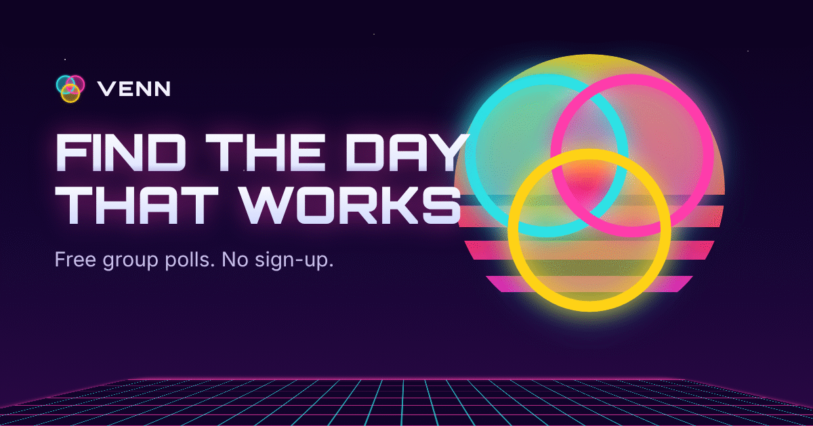
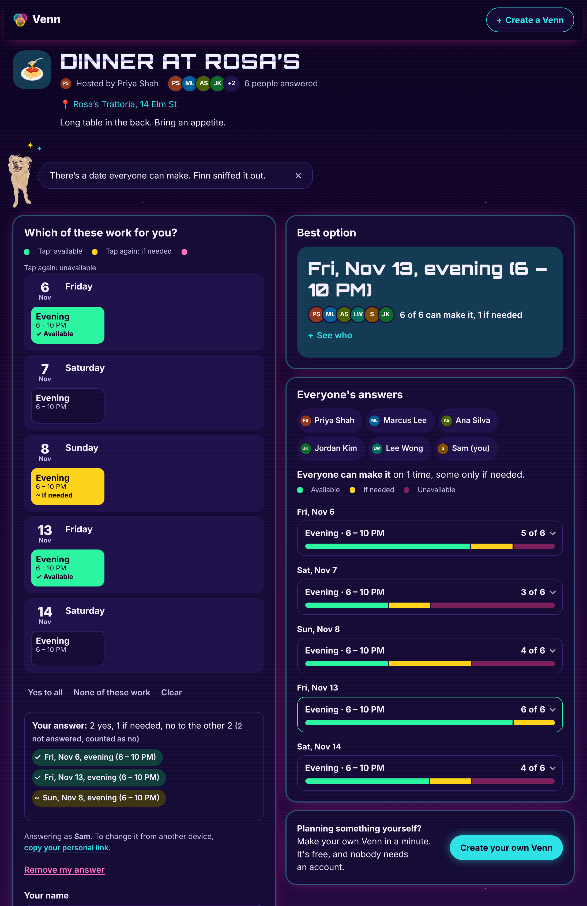

# Venn developer docs



[Venn](https://venn.day/?retro=1) is a free, open-source poll for finding the day that works for dinners, book clubs, trips and other get-togethers. Pick the days that could work, share one link, and everyone marks when they're free; Venn shows where they overlap, best date first. These docs are for people who run, change or build on it.



## Run it locally

You need [Node.js](https://nodejs.org) 22.13 or newer.

```sh
git clone https://github.com/sephmard/venn.git && cd venn
npm install
npm start          # http://localhost:8787, polls saved to data/venn.db
npm run dev:worker # or the Cloudflare Worker, with Wrangler
npm run check      # lint, formatting, docs links, unit and API tests
npm run test:e2e   # browser and accessibility tests, desktop and phone
npm run site       # build these docs into site/
```

Email, calendars and AI switch on only when their settings exist; without them, everything else works.

## How it's built

- **No framework, no build.** Plain HTML, CSS and ES modules in `public/`, served as-is.
- **One API, two hosts.** `src/api.js` is web-standard `Request` → `Response`, run as a Cloudflare Worker with D1 or a Node server with `node:sqlite`.
- **One runtime dependency:** the Anthropic SDK, on the server, for the optional AI features.
- **Shared logic** (time zones, ranking, calendar files) lives in `public/core.js`, used by the browser and the server.

<details>
<summary>Every file, and what it does</summary>

```
public/            the whole front end, served as-is
  index.html       landing page (/); privacy.html and 404.html sit beside it
  app.html         app shell, served for /new and /e/:id
  og.png, og-set.png  link-preview images: asking, and once the date is picked
  og-retro.png, og-set-retro.png  the same, for polls in the retro look
  app.js           router
  create.js        the create pages' shared form parts
  create-free.js   creating a Venn (/new): every new poll
  create-pick.js   the older "vote on a few dates" page (/new/pick), for editing and copying polls made with it
  event.js         the poll page: answering, the group's results, organizer tools
  overlap.js       everyone's answers as the Venn: a row a date or time, or a timeline a day for hours
  organizer.js     the organizer's tools, Notifications and Privacy panels and AI summary, loaded only for organizers
  add-to-calendar.js  "Add to your calendar", loaded once a date is picked
  ai-answer.js     "Answer for me" with AI, loaded when a guest opens it
  day-parts.js     answering hours polls by mornings, afternoons and evenings, and "All day"
  day-answer.js    the organizer's month calendar for answering whole-day polls (tap: available, again: if needed), loaded when shown
  when.js          how a poll's times read ("Fri 11:00 PM – Sat 1:00 AM"), only on the poll page
  celebrate.js     the "Poll created!" celebration
  picker.js        the calendar views: week, day and month, for organizers and guests
  block-edit.js    dragging and removing options on the week, loaded only on the create pages
  paint.js         the organizer's painter for hours and parts of the day, loaded only on the create pages
  levels.js        how picks carry between days, parts of the day and hours on the create page, with paint.js
  half-day.js      half-day options (mornings, afternoons, evenings) on "vote on a few dates", loaded when picked
  lengths.js       how long a poll's options are, for editing, duplicating and the AI draft
  edit-poll.js     editing or duplicating a poll on the create pages, loaded only for those links
  ai-draft.js      "describe it, and AI fills in the form", loaded only when AI is switched on
  day-nav.js       the organizer's day strip, « » and jump-to-a-day month, loaded after the create page
  day-window.js    the days that strip offers
  ui.js            shared UI helpers: formatting, avatars, storage, API calls
  core.js          shared logic: time zones, ranking, calendar import
  calendar-export.js  the .ics file and Google Calendar and Outlook links, for a picked date
  calendars.js     Google / Outlook free-busy, in the browser
  styles.css       the app's light and dark themes
  site.css         landing page styles (see DESIGN.md)
src/
  api.js           JSON API on web-standard Request/Response
  store.js         SQL storage for Cloudflare D1 and node:sqlite
  notify.js        email and webhook notifications
  ai.js            AI features (Claude)
  routes.js        which paths the app handles
  preview.js       each poll's link preview (title, date, image), put into the app shell for /e/:id
  worker.js        Cloudflare Worker entry point
server.js          Node server entry point
test/              unit and API tests (node:test)
e2e/               browser tests (Playwright, desktop and mobile)
docs/              these docs, as Markdown
scripts/           screenshots, link-preview images, the docs site build, link checks
```

</details>

## How data is protected

- **No accounts, cookies or analytics.** The server stores only what people type into a poll, plus the organizer's notification settings.
- **Organizers can keep things private.** Hidden names, hidden answers and collected emails are enforced by the server and never sent to guests. Link previews leave them out too.
- **Links are the keys.** Organizer and edit links carry a secret after the `#`, which browsers never send. The server keeps only a SHA-256 hash, so a database leak can't be used to edit polls.
- **Calendars stay in the browser.** Only free/busy times are read, and the sign-in token never reaches the server. See [Calendars](CALENDARS.md).
- **Strict headers.** Every response carries a Content Security Policy, no-referrer and no-framing headers (`src/security-headers.js`).

Found a security issue? Please report it privately: see [Security](../SECURITY.md).

## Where next

- [Self-hosting](SELF-HOSTING.md): deploy to Cloudflare or any Node server.
- [API](API.md): every endpoint, with request and response shapes.
- [Notifications](NOTIFICATIONS.md), [Calendars](CALENDARS.md), [AI features](AI.md) and [Usage stats](USAGE-STATS.md): setting up each optional feature.
- [Contributing](../CONTRIBUTING.md): setup, tests and how pull requests are reviewed.
